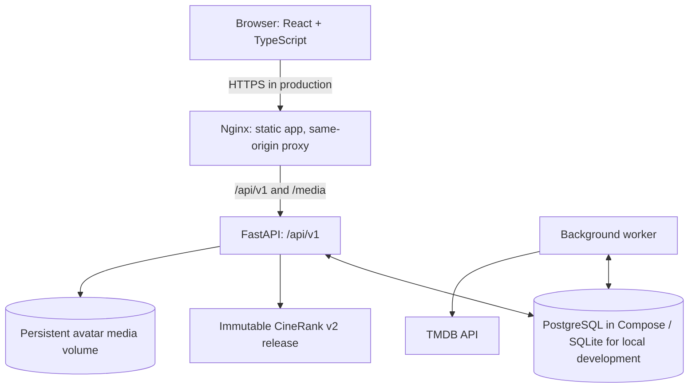
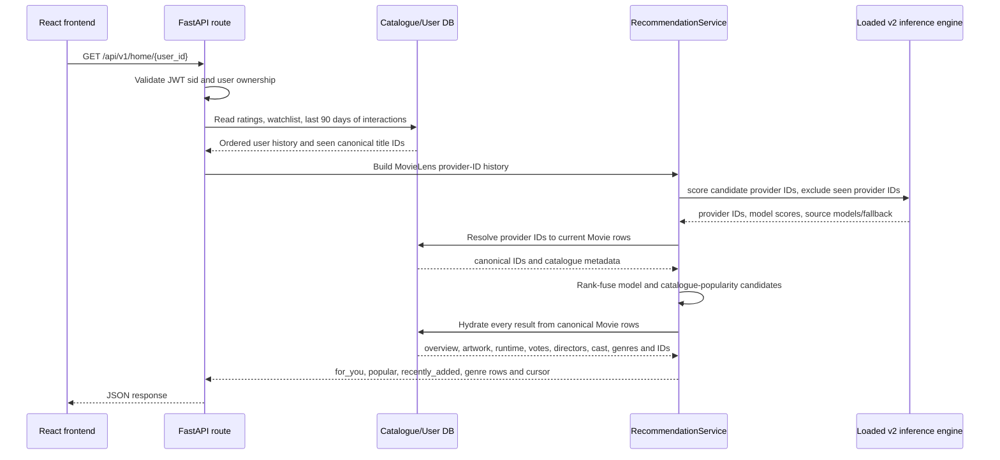

# CineRank Production Architecture

This document describes the implementation in this repository. It distinguishes the application architecture from the separately trained model release and from the infrastructure needed for a public deployment.

## 1. System boundaries



The React application does not connect directly to the database or to model files. It uses the versioned HTTP API. FastAPI owns authentication, authorization, catalogue reads and writes, session state, interaction ingestion, recommendation orchestration and response hydration. The database is the source of truth for catalogue metadata and user state. Model artifacts are read-only inference inputs, not a replacement catalogue database.

The backend package is organized by responsibility:

- `app/api`: HTTP routes, request validation and dependencies.
- `app/core`: configuration, Argon2id/JWT helpers, ID and serial-number rules, Redis coordination, caching and distributed rate limiting.
- `app/db`: database session and schema validation.
- `app/models`: SQLAlchemy entities.
- `app/schemas`: request and response contracts.
- `app/services`: authentication, catalogue and recommendation orchestration.
- `app/ml`: immutable release loading and inference adapter.
- `crawler`: bounded external metadata synchronization.
- `worker`: scheduled catalogue jobs with database-backed leases.

The frontend separates route pages, reusable components, API clients, auth/session handling, query keys and display-format utilities. React Query owns server-state caching. The API client owns credential inclusion, access-token attachment, refresh coalescing and error conversion. The frontend uses React + TypeScript + Vite; Nginx serves the compiled SPA and reverse-proxies `/api/v1` and `/media` on the same origin. This is intentional: no Next.js migration is required for the current client-rendered product.

Redis is now a shared infrastructure dependency for distributed request/auth rate limits and short-lived recommendation response caching. PostgreSQL remains the source of truth. Cache keys include user ID, model release, activity count, catalogue version and preference version; cache loss must not lose user or catalogue data. Production startup configuration requires `REDIS_URL`; readiness checks Redis. Local development without Redis uses bounded process-local rate limiting and skips shared caching.
Nginx is the selected edge proxy and static frontend server. Its DNS-aware upstream uses round-robin balancing across API replicas; API workers are stateless with session state in PostgreSQL and shared limits/cache in Redis, so sticky sessions are not required. Compose can scale the API with `docker compose up -d --scale api=3`. The API trusts forwarded headers only from the fixed private Nginx proxy address. PostgreSQL pool defaults are 5 connections plus up to 10 overflow per process; calculate the total across API replicas and workers against the database's connection budget before scaling.
Initial shared quotas are configurable: login 5/minute per IP and account, registration 5/hour per IP and username, refresh 10/minute, search 30/minute, recommendations/home 20/minute, ratings 20/minute, watchlist writes 30/minute, interactions 60/minute, and other public reads 240/minute. Authenticated requests are limited by both source IP and token subject. These are starting limits, not traffic-derived optimal values; tune them with load and abuse telemetry. Redis Lua scripts make the sliding-window update atomic across replicas; production fails closed if Redis cannot enforce the limit.

## 2. Identity and catalogue data model

`movies.title_id` is the immutable canonical CineRank identity. It is generated as `title_<UUIDv7>` for new titles. `serial_number` is a separate permanent human-readable route identifier. MovieLens, TMDB and IMDb IDs are source/provider identifiers and are never substituted for `title_id`.

The mapping direction is explicit:

```text
provider item ID -> database Movie row -> canonical title_id -> API response
```

The inference engine returns MovieLens provider IDs because the trained release was built from MovieLens. The API queries `Movie.movielens_id` to resolve each candidate to the current database record, then returns `title_id`, serial number and current database metadata. It does not align records by row position, alphabetical order or array offset. A missing provider mapping is skipped rather than returned as a malformed result.

The `movies` catalogue stores the provider mappings and presentation metadata, including normalized display title, release year, genres, overview, poster/backdrop paths, popularity, vote fields, runtime, director and cast JSON. A reproducible importer populates these fields from a downloaded TMDB/IMDb dump plus MovieLens TMDB links. It matches by exact provider ID first, rejects incompatible release years, and only accepts unique normalized title plus exact year as a fallback. The API serves the database values. Missing values are not fabricated in the frontend. `display_title` is a presentation field; the raw provider title remains unchanged. Year is returned separately and must not be concatenated into the visible title.

The source MovieLens catalogue may lack external metadata. A controlled TMDB backfill enriches records outside the request path. It is dry-run by default, checks title/year similarity, rejects ambiguous matches and fills missing values only unless overwrite is explicitly requested. Normal API reads never make an external TMDB request for every card.

## 3. End-to-end HTTP and frontend flow

In the supported Compose deployment, the browser calls one origin. Nginx serves the static SPA and proxies `/api/v1/*` to FastAPI. It proxies `/media/*` to the API's persistent media mount. The frontend must not call PostgreSQL or the model engine.

Typical authenticated request:

1. A React page calls a typed function in `frontend/src/api/endpoints.ts`.
2. The shared API client attaches the in-memory bearer access JWT and sends cookies with `credentials: include`.
3. Nginx forwards the original API path. FastAPI request middleware assigns or accepts a request ID and records method, path, status and latency.
4. FastAPI validates the schema and authenticates the JWT. The JWT `sid` is checked against a live database session. Route-level ownership checks ensure a user cannot read or mutate another user's resources.
5. The service queries or mutates the database in a transaction. Responses use Pydantic schemas and stable catalogue identifiers.
6. FastAPI returns JSON and an `X-Request-ID`. React Query updates or invalidates the relevant cache keys.

The title detail, card, search and watchlist experiences consume database-backed title metadata through API responses. Loading, empty, not-found, unavailable and generic-error states are explicit. The frontend does not infer a movie's release year from its title string after receiving structured fields.

## 4. Authentication and long-lived sessions

The authentication design uses two distinct credentials with different lifetimes and storage rules.

| Credential | Form | Browser storage | Purpose |
|---|---|---|---|
| Access token | Signed JWT, default 15 minutes and production max 15 minutes | JavaScript memory only | Bearer authorization for API calls |
| Refresh token | Opaque high-entropy token bound to a server-side session | `HttpOnly` cookie, `Secure` in production, scoped to `/api/v1/auth` | Obtain a new access JWT without asking the user to sign in again |

The browser stores only a non-secret `cinerank.has_session` hint in localStorage. It contains no access or refresh token. On reload, that hint triggers a refresh-cookie bootstrap. The access JWT is decoded only to schedule proactive renewal; its signature is always validated by the backend.

Refresh rotation is stateful:

1. Login validates the password and creates a `user_sessions` row.
2. The backend sends a random opaque refresh token in an HttpOnly cookie and returns a short-lived access JWT with a session ID (`sid`).
3. The database stores only the refresh-token hash, not the raw cookie value.
4. The frontend refresh client is single-flight so parallel 401s do not race token rotation. An active, visible browser renews shortly before access expiry after recent interaction.
5. A successful refresh replaces the stored token hash, updates last-used time and extends the sliding inactivity expiry (30 days by default).
6. A refresh token replay outside the small concurrency grace window revokes the session. Logout revokes the server session and clears the cookie. Logout-all, logout-others and per-session revoke are supported.
7. A JWT with an unknown, revoked, expired or invalid session ID is rejected even when its cryptographic signature is otherwise valid.

The current frontend's active-window policy refreshes when the tab is visible, the user has had activity within 30 minutes, and the access token is within five minutes of expiry. The refresh cookie's server-side sliding lifetime is 30 days by default. This distinguishes an active user who is reading from a tab that has been idle for a long period. Multiple tabs share the browser cookie; refresh calls are coalesced within a page, and the backend concurrency/reuse rules provide the server-side safety boundary.

Important security properties:

- Access JWTs are memory-only. XSS can still execute actions in an authenticated page, so strict output handling, dependency hygiene and a production Content Security Policy remain required.
- Refresh cookies are HttpOnly and cannot be read by ordinary page JavaScript. They are Secure in production and SameSite=Lax by default.
- Refresh and logout endpoints validate request Origin and Fetch Metadata signals.
- Login, registration, refresh, logout, avatar upload and profile update have endpoint-specific quotas. API traffic also has IP- and authenticated-user-scoped distributed sliding-window limits in Redis; local development uses a process-local fallback.
- Passwords use Argon2id (19 MiB memory, two iterations, one lane); successful verification transparently upgrades legacy scrypt hashes. Email/password changes require the current password.
- Email confirmation and password reset tokens are hashed at rest, single-use and time-limited. Password reset revokes all refresh sessions.
- Session listing and revocation are scoped to the authenticated owner. Password changes revoke other sessions while retaining the current session.
- Authentication and access logs never print passwords, access tokens, refresh cookies or request bodies.

The profile page can update username and email, change password, upload/remove an avatar, list active sessions, revoke a selected session and sign out other devices. Avatar uploads are limited to JPEG/PNG/WebP and 2 MB, decoded and re-encoded server-side to a small WebP image. The upload is not stored as base64 in the users table.

Email changes still require the current password. A changed address is marked unverified, and the user can resend a confirmation link from the profile page. Verification and password reset use random single-use tokens; only a SHA-256 hash is stored in `email_action_tokens`. Links expire after 24 hours for verification and 60 minutes for reset, and issuing a new link invalidates older unused links for that purpose. Password reset revokes every refresh session.

Delivery is SMTP-based and configured with `SMTP_HOST`, `SMTP_PORT`, sender credentials, `SMTP_STARTTLS` or `SMTP_SSL`, and `FRONTEND_BASE_URL` for the link origin. The public endpoints return a generic response so account existence is not disclosed, and they return `503` when SMTP is not configured. Tests use an injected fake sender; real inbox delivery requires provider credentials and is not claimed by the local suite.

## 5. API surface and ownership

All application routes are under `/api/v1`.

| Route | Purpose | Access |
|---|---|---|
| `POST /auth/register` | Create account | Public, rate-limited |
| `POST /auth/token` | Login, create session, set refresh cookie | Public, rate-limited |
| `POST /auth/refresh` | Rotate refresh token and issue access JWT | Refresh cookie + Origin checks |
| `POST /auth/logout` | Revoke current refresh session and clear cookie | Refresh cookie + Origin checks |
| `POST /auth/logout-all` | Revoke all user's sessions | Authenticated |
| `POST /auth/logout-others` | Revoke all except current session | Authenticated |
| `POST /auth/email/verification/request` | Send a single-use email confirmation link | Authenticated |
| `POST /auth/email/verify` | Consume a confirmation token and verify the email | Public token |
| `POST /auth/password/forgot` | Request a reset link with a generic response | Public, rate-limited |
| `POST /auth/password/reset` | Consume a reset token, update the password, revoke sessions | Public token, rate-limited |
| `GET /auth/sessions` | List active sessions | Authenticated |
| `GET/PUT /users/me/preferences` | Read/update explicit recommendation preferences | Authenticated |
| `GET /recommendations` | Canonical personalized recommendations for current user | Authenticated |
| `DELETE /auth/sessions/{session_id}` | Revoke an owned session | Authenticated |
| `GET/PATCH /auth/me` | Read or update current profile | Authenticated |
| `PATCH /users/{user_id}` | Compatibility profile update with self-ownership guard | Authenticated, owner only |
| `POST /users/me/avatar` | Validated avatar upload | Authenticated |
| `GET /titles/{media_type}/{serial_number}` | Resolve public human-readable title route | Public catalogue read |
| `GET /titles/{media_type}/{serial_number}/similar` | Item-to-item neighbours for one title, with catalogue fallback | Public catalogue read |
| `GET /movies/{title_id}` | Resolve canonical title identity | Public catalogue read |
| `GET /movies` | Catalogue browse and pagination | Public catalogue read |
| `GET /catalogue/facets` | Genre/media facets | Public catalogue read |
| `GET /search` | Parameterized database title search | Public catalogue read |
| `POST /ratings` | Create/update own rating | Authenticated |
| `POST /interactions` | Record own click/play/complete/like/dislike/skip/impression/rating event | Authenticated |
| `GET /users/{user_id}/history` | Read rating history | Authenticated, owner only |
| `GET/POST/DELETE /watchlist` | Read and mutate own watchlist | Authenticated |
| `GET /home/{user_id}` | Personalized, popular, recent and genre rows | Authenticated, owner only |
| `GET /home/{user_id}/more` | Cursor-based continuation | Authenticated, owner only |
| `GET /recommendations` | Canonical recommendations for authenticated user | Authenticated |
| `GET /recommend/{user_id}` | Compatibility recommendation response | Authenticated, owner only |
| `GET /health/live` | Liveness check | Public/internal |
| `GET /health/ready` | Database and model readiness | Public/internal |
| `GET /models` | Loaded model/release status | Public/internal |

The catalogue table is authoritative: the recommendation model provides ranking scores and provider item IDs, never movie names or descriptive metadata. After inference, the service resolves provider IDs to `Movie` rows, rank-fuses candidates by immutable `title_id`, then hydrates the full output from those rows. `RecommendationItem` extends `MovieOut`, so `for_you`, `popular`, `recently_added`, genre rows and cursor pages carry the complete available catalogue contract: `title_id`, public serial, provider IDs, media type, normalized display title, stored/original title, year, genres, overview, poster/backdrop, popularity, vote average/count, runtime, directors, cast, adult-content flag and source, plus recommendation score/reason. The frontend types model this as `RecommendationItem extends Movie`; the home hero uses the returned overview and backdrop and does not issue a duplicate detail request. Missing database metadata remains null until a controlled catalogue enrichment fills it.

## 6. Recommendation and inference request lifecycle

The v2 release is loaded once per API process through `ProductionModelRegistry`. The registry verifies checksums, rejects incomplete or unsupported bundles, initializes the fast inference engine and warms the available model paths. It is not loaded for every request. The API process has a bounded 1,024-entry inference cache by default; the recommendation-row cache uses a short TTL and is keyed by user, feed shape, release ID and activity count.

A home request follows this sequence:



The history is assembled from ratings, watchlist and recent non-impression interaction events. Current event signals include click, play, complete, like, dislike and skip. The implementation maps those events to weighted preference values. Seen titles and watchlist titles are filtered from recommendations. User activity writes invalidate the user's cached recommendation rows.

Similar titles reuse the source title's trained ItemKNN row. The service maps the returned provider IDs back to catalogue rows in model order, keeps the same media type, excludes the source, and fills any shortfall with content neighbours, then same-genre catalogue titles ordered by popularity. The response is capped at 24 items. This is item-to-item neighbourhood scoring, not a second user ranking, and it does not expose raw similarity values in the UI.

The hybrid model uses the trained v2 artifacts for mapped MovieLens items. The current catalogue popularity list is computed from CineRank's own `popularity`, `vote_average`, `vote_count` and creation time fields. The ranker combines model and catalogue candidates. Newly added database titles without a MovieLens mapping are not invented into the trained provider-ID matrix; they can appear in the catalogue-popularity/recent rows. Full new-title content-vector scoring needs a validated extension of the exact release's fitted content transform before it can be treated as part of the trained content model.

Cold-start behavior is explicit. With no or little user history, the fast model engine uses its declared popularity fallback for `for_you`; the home response also includes a catalogue-popularity row, recently added row and default genre rows (Action, Drama, Comedy unless the request supplies genres). As interactions accumulate, the user's ordered history is folded into the next recommendation request. The hero's Top Pick uses the first current personalized result when available, otherwise the cold-start selection.

The endpoint returns the complete available database title record with recommendation score/reason. A score is a ranking value, not a calibrated probability. The frontend renders only the fields appropriate to each surface, while the full metadata remains available for detail cards, hero context and future UI features.

Pagination cursors are signed, bound to the user and release ID, expire, and fail closed if the model bundle changes between pages. Clients must treat them as opaque and restart pagination after a `400` cursor error.

## 7. Model release engineering

The active model format is v2. It is a separate immutable release under `backend/artifacts/models/releases/`. The manifest describes release/version and model availability. `SHA256SUMS` protects release files against accidental or partial changes. The bundle includes numerical arrays/sparse matrices for popularity, content, ItemKNN, ALS and BPR, plus an ONNX attention graph and safetensors weights/configuration. The inference adapter reads the manifest and exact file layout; it does not infer a v2 release from a v1 directory.

Legacy v1 lifecycle code remains in the repository for historical/training compatibility, but it must not overwrite the v2 serving release. The background worker's automatic model refresh is deliberately disabled. A model upgrade is an offline release-engineering process:

1. Train a candidate with a pinned environment and recorded input/data provenance.
2. Evaluate on temporal train/validation/test partitions with a common candidate set and seen-item policy.
3. Compare ranking, coverage, diversity, novelty and long-tail exposure. Do not select on test metrics.
4. Validate item/provider ID uniqueness, shapes, finite values, manifest and every checksum.
5. Test the exact production loader, fold-in, CPU/GPU behavior where supported, padded/unpadded attention paths and API response mapping.
6. Stage the release in a new immutable directory. Do not mutate an active release in place.
7. Deploy after an explicit promotion decision and retain the previous release for rollback.

The serving path fails readiness when the configured v2 release is absent, incomplete or incompatible. This is intentional. It does not silently substitute v1 artifacts or claim recommendations are available when the engine is not ready.

## 8. User-facing experience and design contracts

- The navbar search is available across routes. It debounces database search, shows a modal/dimmed backdrop, loading skeletons, empty/error states, supports keyboard navigation, Escape and outside-click closing, and links to a title or full search results.
- Horizontal poster rails use non-shrinking cards with explicit widths and consistent gaps. The edge fade is applied with a soft multi-stop mask. Vertical clipping is avoided so poster shadows and focus rings are not cut off.
- Display titles are normalized by frontend and backend utilities. A terminal `(YYYY)` suffix is removed from the display name; the year remains in a separate metadata field.
- The intro uses a 2.8-second red-ribbon logo build, mark before wordmark, once per browser session, without a skip action. Branded skeletons and a short page loader follow it. Default audio can still be blocked by browser autoplay policy until a user gesture.
- Custom not-found and error-boundary states render within the branded application shell. The API remains the source for HTTP status semantics; frontend routes do not replace authorization or existence checks.

## 9. Error and availability behavior

Expected API status handling:

| Status | Meaning | Frontend behavior |
|---|---|---|
| `400` | Invalid cursor or invalid request semantics | Explain and reset the affected flow |
| `401` | Missing/expired/revoked authentication | Attempt refresh once; if it fails, clear memory session |
| `403` | Authenticated but not permitted / reauthentication required | Show permission or current-password prompt |
| `404` | Title, user-owned resource or route does not exist | Render not-found state |
| `409` | Conflict such as duplicate username/email or changed catalogue cursor | Show corrective action, do not silently retry |
| `413` | Upload or request body too large | Show size guidance |
| `422` | Schema validation failure | Show field/request feedback |
| `429` | Rate limit | Show retry guidance and respect response headers when present |
| `500` | Unexpected server error | Show generic error and retain request ID for support |
| `503` | DB, Redis (when configured), or model release unavailable | Show temporary unavailable state; do not pretend recommendation data is valid |

Liveness is separate from readiness. `/health/live` says the process is running. `/health/ready` requires database connectivity, Redis connectivity when configured, and a validated model release. An app can therefore be alive but not ready to serve recommendations.

## 10. Deployment and trust boundaries

The root Dockerfile has independent `api` and `web` targets. Compose runs:

- `db`: PostgreSQL, private named data volume, no published host port.
- `redis`: authenticated private cache/rate-limit service, bounded memory and named persistence volume, no published host port.
- `migrate`: one-shot Alembic upgrade before application startup.
- `catalogue-bootstrap`: imports the sanitized seed only when the catalogue is empty, skips unrelated populated catalogues, and fails on partial seed collisions.
- `api`: non-root FastAPI service, on frontend and internal backend networks. Its container health is based on process liveness so missing model files do not prevent non-recommendation APIs and the web client from starting.
- `worker`: separate non-root scheduler, on the internal DB network and a dedicated outbound egress network for TMDB.
- `web`: Nginx serving built SPA, public HTTP entry point, round-robin proxying API and avatar media across API replicas.
- `prometheus` and `grafana`: optional `monitoring` profile, private metrics collection, provisioned dashboard and dashboard access bound to localhost ports.

Only Nginx publishes a host port by default. API and database ports stay inside Compose networks. Uvicorn trusts forwarded headers only from the fixed private Nginx proxy address used by Nginx. The backend network is internal; the worker gets outbound egress as required for its metadata crawler. User uploads, logs and PostgreSQL persist in named volumes.

The included Nginx container serves HTTP. Public production traffic must terminate TLS at a managed load balancer or hardened HTTPS ingress before reaching it. Set secure cookies, strict origin allowlists, strong keys and environment-specific host rules. Do not expose `/docs`, `/redoc` or OpenAPI JSON on the public Nginx route. Do not place secrets in frontend build arguments.

## 11. Database migrations and catalogue bootstrap

Alembic is the only schema migration authority. Automatic ORM `create_all()` is disabled by default. A startup schema guard checks important columns and reports the migration command when an old SQLite file is behind.

The migration graph has a single current head `d0e1f2a3b4c5`, merging the user-avatar URL and permanent title serial-number branches, enforcing non-null serial numbers, adding explicit user recommendation preferences, adding email verification plus single-use action tokens, and binding those tokens to the address they were issued for. Existing DBs should be backed up and upgraded with `python -m alembic upgrade head`; never delete a production/local DB to solve a column mismatch.

The repository includes `backend/data/seeds/catalogue_movielens.jsonl`, a privacy-sanitized 5,750-title catalogue bootstrap. It contains no users, password hashes, ratings, interactions, watchlists or sessions. `scripts/import_catalogue_seed.py` is dry-run by default, imports only into an empty catalogue, is idempotent for the exact seed and updates the next serial value. The Docker-only `scripts/bootstrap_catalogue.py` imports on an empty database, skips an unrelated populated catalogue and fails if it detects a partial collision with the bundled seed.

## 12. Logging and observability

Every HTTP request receives or generates a bounded request ID. The API and worker use `app/core/logging_config.py` as the single logging setup. Terminal output is one aligned line per event with timestamp, level, logger, message and structured fields. The rotating file at `LOG_DIR/LOG_FILE_NAME` (default `backend/logs/cinerank.log`) stores one JSON object per line so request IDs and timings can be filtered without parsing free text. Rotation defaults to 10 MB with five backups and is configurable with `LOG_MAX_BYTES` and `LOG_BACKUP_COUNT`.

Access logs include request ID, method, path (not query string), status and duration. Uvicorn's built-in access logger is disabled so requests are not duplicated or emitted without the application request ID. Unhandled exceptions include the same request ID and a full traceback in the file. Security events use named event codes and user/session IDs where relevant, but do not include tokens or passwords. Do not enable SQL parameter echo in production.

Read recent rows with the bundled viewer:

```bash
cd backend
python scripts/show_logs.py --tail 100
python scripts/show_logs.py --level WARNING
python scripts/show_logs.py --request-id <id>
python scripts/show_logs.py --follow
```

In containers the API and worker share the `cinerank-logs` volume at `/app/logs`. Collect the JSON lines centrally with retention, and alert on repeated 401/403/429, elevated 5xx, readiness failures, worker lease failures and model-load errors.

Prometheus metrics are exposed at `/metrics` on the private API network, and Nginx blocks public access to that path. They cover HTTP request rate and latency, recommendation duration by cache outcome, shared and in-memory recommendation cache events, inference and ranking duration, recommendation item counts, Redis operation failures and database health/readiness failures. The optional Compose `monitoring` profile runs Prometheus with Docker DNS discovery for API replicas and Grafana with a provisioned datasource and dashboard for these signals. `deploy/prometheus-alerts.yml` defines alerts for API downtime, 5xx ratio, readiness failures, latency, slow recommendations, low shared-cache hit rate, Redis/database failures and rate-limit spikes. Distributed tracing, persistent audit-log export and external alert routing remain deployment integrations, not claims of completed functionality.

## 13. Verification record and limitations

Executed in the current workspace:

- Backend: 67 tests passed and 2 live-Redis integration tests skipped. The passing suite includes authentication and ownership, Argon2id migration, preferences, catalogue integrity, recommendation ranking, and the legacy portable-model tests.
- Fresh SQLite Alembic upgrade reached `d0e1f2a3b4c5` and the runtime schema guard passed. `alembic check` reported no new upgrade operations.
- Backend: 74 tests passed with 2 live-Redis tests skipped.
- Frontend: clean lockfile install, typecheck, lint, 87 tests and production build passed. `npm audit` reported no known vulnerabilities after Vitest was upgraded to 5.1.1.
- Runtime dependency audit passed with no known vulnerabilities.
- A live local SQLite API loaded the model artifacts and served recommendations. The local load smoke completed with zero server errors; detailed latency and rate-limit results are recorded in `PRODUCTION_READINESS.md`.
- Compose, CI, Prometheus and Grafana provisioning YAML parsed. The Grafana dashboard JSON parsed. Backup and restore scripts passed shell syntax validation.

Not executed here:

- Docker image builds, Compose startup, Nginx 1.28 runtime, PostgreSQL migrations, live Redis integration, replica balancing, Prometheus scraping and Grafana rendering. Docker, Redis and PostgreSQL are unavailable in this workspace.
- Real SMTP delivery to an external inbox. Email code and fake-sender tests run locally; no mail provider credentials or sender domain are configured.
- Backup restoration into a real database. The procedure exists; the drill is blocked on PostgreSQL.
- Browser end-to-end, accessibility, production-scale load and formal security testing.
- Persistent audit-log export, external alert routing and distributed tracing.

The GitHub Actions workflow defines PostgreSQL migration, Redis integration and dependency-scan jobs, but the workflow has not been run on GitHub. Unit and local SQLite results are not proof of a deployed production system.

## Frontend recommendation route

The frontend includes a dedicated protected `/recommendations` page backed by `GET /api/v1/recommendations?k=24`; user identity is derived from the authenticated access token rather than a caller-supplied user ID. It renders the backend-ranked and catalogue-hydrated response without re-ranking or exposing model scores as probabilities. Visible-card impressions and explicit `like`/`dislike` feedback use the existing `/interactions` event contract. The grouped personalized home remains backed by `/home/{user_id}`. Title pages render ten similar titles in a horizontally scrollable rail and expand the rail toward 24 titles once the reader approaches its end. The home `For you` rail requests its next cursor page about one viewport before the user reaches the end, so appended cards are already available when the edge is reached. Cursor pages remain opaque and server-issued. Anonymous readers can use the public similar-titles route; signed-in title visits continue to record the `click` interaction that feeds the next recommendation request. A protected `/preferences` page uses `GET/PUT /api/v1/users/me/preferences` to persist explicit preferred/excluded genres, adult-content inclusion, minimum release year and maximum runtime. The recommendation service applies those filters and a modest preferred-genre boost. Public `/forgot-password`, `/reset-password` and `/verify-email` pages complete the account recovery flows. The profile page shows unverified email state and can resend the confirmation link.
