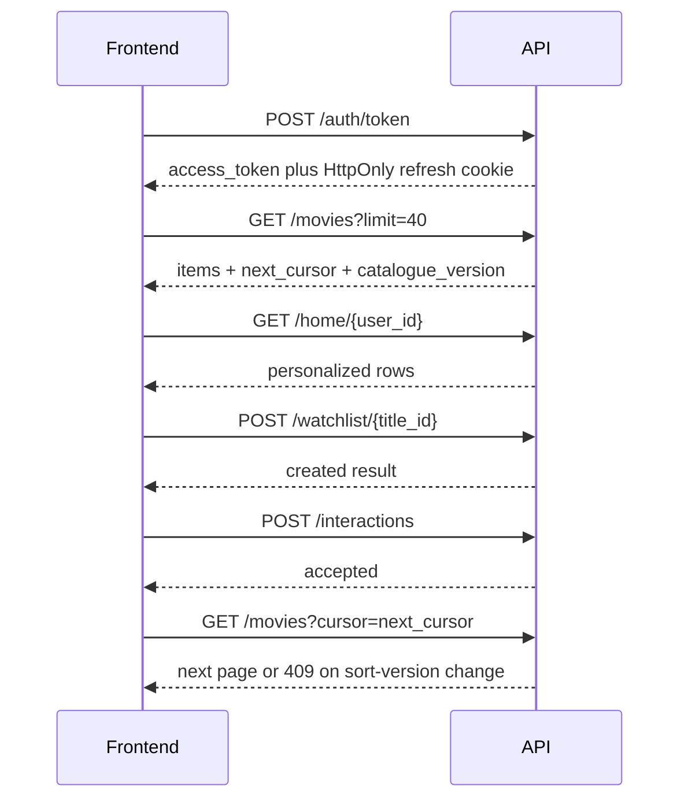

# HTTP API Contract

Base path: `/api/v1`. OpenAPI is served at `/docs` and `/redoc`. JSON responses expose `title_id` as the durable internal catalogue identifier and `serial_number` as the permanent public identifier. Clients must never construct or infer IDs from display positions or provider IDs.

`title_id` remains authoritative for API mutations, foreign keys, ratings, watchlists, interactions, recommendation references, and React keys. `serial_number` is a six-digit public value used in canonical routes: `/movie/{serial_number}/` and `/tv/{serial_number}/`.

## Authentication

Registration is `POST /auth/register`. Login uses OAuth2 password form fields (`username`, `password`) at `POST /auth/token` and returns `access_token`, `token_type`, and `expires_in`. Send the access token as `Authorization: Bearer <token>`. Access tokens are short-lived signed JWTs with `sub`, `iss`, `aud`, `iat`, `nbf`, `exp`, `jti`, `sid`, and `type` claims. `/auth/me` returns the authenticated account. User-owned operations enforce that the authenticated user matches the requested user where applicable.

Login also sets an opaque refresh token in an HttpOnly cookie scoped to `/api/v1/auth`. The refresh token is not included in the JSON body. `POST /auth/refresh` reads the cookie, validates the request Origin, rotates the refresh token, and returns a new access token. Only a SHA-256 hash of the refresh token is stored. Immediate replay of the previous token during the configured concurrency grace window returns 401 without revoking the session. Replay after that window revokes the session. Expired, revoked, malformed, and inactive-account sessions return 401 and clear the cookie.

Cookie-authenticated refresh and logout requests require a valid `Origin` header. Cross-site `Sec-Fetch-Site` requests are rejected. In production, the cookie is Secure, HttpOnly, and SameSite Lax or Strict, and `CORS_ORIGINS` must list explicit trusted origins.

`POST /auth/logout` revokes the current session. `POST /auth/logout-all` revokes every session for the authenticated user. `GET /auth/sessions` lists active sessions with `current` marking the calling session. `DELETE /auth/sessions/{session_id}` revokes one session owned by the authenticated user. Access tokens issued before this session model was deployed do not contain `sid` and are rejected, so affected users must sign in again.

## Endpoint inventory

| Method | Path | Authentication | Purpose |
|---|---|---|---|
| GET | `/health` | Public | Database/model health summary |
| GET | `/health/live` | Public | Process liveness |
| GET | `/health/ready` | Public | Readiness; 503 when DB, configured Redis, or model registry is unavailable |
| GET | `/models` | Public | Loaded model names and active bundle metadata |
| POST | `/auth/register` | Public | Create account |
| POST | `/auth/token` | Public | Obtain access JWT and set refresh cookie |
| POST | `/auth/refresh` | Refresh cookie plus Origin | Rotate refresh token and issue access JWT |
| POST | `/auth/logout` | Refresh cookie plus Origin | Revoke current session and clear cookie |
| POST | `/auth/logout-all` | Bearer | Revoke all sessions for the current user |
| GET | `/auth/sessions` | Bearer | List active sessions; mark the current one |
| DELETE | `/auth/sessions/{session_id}` | Owner bearer | Revoke one owned session |
| GET | `/auth/me` | Bearer | Current account |
| GET | `/users/me/preferences` | Bearer | Current user's explicit recommendation preferences |
| PUT | `/users/me/preferences` | Bearer | Replace current user's recommendation preferences |
| GET | `/movies` | Public | Keyset-paginated catalogue with optional filters |
| GET | `/catalogue/facets` | Public | Available media types and genres with title counts |
| GET | `/titles/{media_type}/{serial_number}` | Public | Fetch a title by media type and public serial number |
| GET | `/movies/{title_id}` | Public | Fetch a title by immutable internal ID; retained for legacy URL resolution |
| GET | `/search?q=...` | Public; optional bearer for user search logging | Search catalogue titles |
| POST | `/ratings` | Bearer | Create/update the current user's rating |
| POST | `/interactions` | Bearer | Record a user interaction event |
| GET | `/users/{user_id}/history` | Owner bearer | User rating/interaction history |
| POST | `/watchlist/{title_id}` | Bearer | Add title to current user's watchlist |
| DELETE | `/watchlist/{title_id}` | Bearer | Remove title from current user's watchlist |
| GET | `/watchlist` | Bearer | Current user's watchlist |
| GET | `/home/{user_id}` | Owner bearer | Home recommendation rows |
| GET | `/home/{user_id}/more` | Owner bearer | Continue recommendation rows using cursor |
| GET | `/recommendations` | Bearer | Ranked recommendations for authenticated user; supports `k` |
| GET | `/recommend/{user_id}` | Owner bearer | Legacy ranked recommendation response |

Exact query constraints and response models are defined in `app/api/routes.py` and `app/schemas/schemas.py`; OpenAPI generated by the running version is authoritative.

## Catalogue pagination

`GET /movies?limit=50&media_type=movie&genre=Drama` returns `items`, `next_cursor`, and `catalogue_version`. The cursor is signed with `SECRET_KEY` and bound to the active catalogue version and filters. Pass it unchanged to fetch the next page. If the daily job publishes a new order between requests, the API returns HTTP 409; restart pagination without a cursor. Do not use offsets for deep catalogue pages.

`GET /catalogue/facets` returns only values that exist in the catalogue. The response shape is `{media_types: [{value, count}], genres: [{value, count}]}`. Clients use this to hide unavailable media tabs and build genre filters instead of hard-coding a full taxonomy.

Each title has a permanent `title_id` and a permanent six-digit `serial_number`. Fields such as `title`, `media_type`, `year`, `genres`, `overview`, `poster_path`, `backdrop_path`, `vote_average`, `runtime`, and source identifiers are metadata. Use `serial_number` for public links, `title_id` for watchlists, ratings, interactions, recommendation references, and UI keys. Do not render `title_id`, `serial_number`, provider IDs, or provider source names in visible UI text or accessible labels.

The raw provider `title` is preserved exactly. `MovieOut`, recommendation items, and history items also include a computed `display_title` that moves a trailing library article to the front, for example `Matrix, The (1999)` becomes `The Matrix` while `year=1999` remains a separate field. This is presentation-only and does not mutate catalogue data. Clients should render `display_title` and keep `title` for provenance and debugging.

`GET /titles/movie/000001` and `GET /titles/tv/000025` resolve the public route. The media type is part of the lookup, so a movie serial cannot resolve a TV title. `GET /movies/{title_id}` remains available for legacy URLs, which the frontend redirects to the canonical serial route.

## Example catalogue response

```json
{
  "items": [
    {
      "title_id": "title_019...",
      "serial_number": "000001",
      "media_type": "movie",
      "title": "Example Film",
      "display_title": "Example Film",
      "year": 2025,
      "genres": "Drama|Mystery"
    }
  ],
  "next_cursor": "<signed-opaque-cursor-or-null>",
  "catalogue_version": 12
}
```

The abbreviated object above is illustrative; the complete `MovieOut` schema is emitted by OpenAPI. Do not assume omitted optional metadata is always present.

## Rating and interaction semantics

A rating references `title_id`, not MovieLens/TMDB IDs. The API derives the user from the bearer token; clients should not submit another user's ID. Interaction `event_type` values include impression, click, play, complete, and like. Event metadata must not contain secrets or unnecessary personal information.

## Recommendation response and cold-start

Recommendation responses identify each item with `title_id`, `serial_number`, and `display_title` and include rank/score/source metadata as defined by the Pydantic schema. The same identity fields are included in search, watchlist, and rating-history title objects. The service excludes titles already rated, saved to the watchlist, or recently interacted with. The home hero rotates among the top unseen items as the user's activity count changes. The API caches each user's home rows in Redis for a short TTL, with a bounded process-local fallback. Cache keys include account, model release, activity count, catalogue version and explicit preference version. Rating, watchlist, interaction and preference writes change the relevant cache version. Redis is not a source of truth. Newly crawled titles without a MovieLens model index can still be scored by the frozen content vectorizer and candidate popularity signals. Collaborative factor models only score items represented in their trained factor matrices.

## Frontend integration sequence



## Error handling

- `400`: malformed cursor or invalid request.
- `401`: missing/invalid bearer token or ownership check failure.
- `404`: unknown title/user resource.
- `409`: duplicate registration or catalogue version changed.
- `422`: Pydantic validation failure.
- `429`: request/authentication rate limit exceeded; honor `Retry-After`. Redis-backed sliding windows apply IP and authenticated-user quotas across API replicas. Account-level quotas additionally protect login/registration identities.
- `503`: readiness dependency unavailable.

Clients should handle 409 catalogue pagination by restarting the listing, 401 by re-authenticating, and 503 with bounded retry/backoff. Never blindly retry non-idempotent writes without an idempotency strategy.

## Explicit recommendation preferences

`GET /users/me/preferences` returns persisted settings or defaults. `PUT /users/me/preferences` replaces the settings with preferred genres, excluded genres, adult-content inclusion, minimum release year and maximum runtime. Preferred genres receive a modest ranking boost; excluded genres, adult policy, and configured year/runtime limits are eligibility filters. The API derives the user from the bearer token and does not accept a caller-supplied user ID for this resource.
