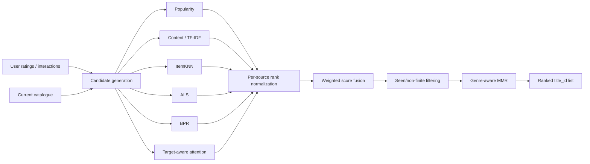

# Candidate Generation and Production Ranking

## Overview

The recommendation service separates candidate generation from final ranking. Candidate sources can have incomparable raw scales (dot products, cosine similarity, popularity counts, or neural logits), so the production ranker converts each source's candidate list to within-source rank scores before weighted fusion. It then applies a genre-aware maximal marginal relevance (MMR) selection pass.

## Candidate sources and default weights

The current implementation defaults are declared in `ranker/production_ranker.py`:

| Source | Weight |
|---|---:|
| attention | 0.26 |
| ALS | 0.21 |
| BPR | 0.13 |
| ItemKNN | 0.10 |
| content | 0.10 |
| content cold-start | 0.12 |
| popularity model | 0.06 |
| live catalogue popularity | 0.02 |

These are starting weights, not validated universal optima. Bundle hybrid configuration can override source weights; the ranker retains serving-only defaults when a partial configuration is supplied.

## Within-source normalization

For each source, candidates are sorted descending by source score. A candidate at zero-based rank `r` among `n` candidates receives:

\[
s_{rank}=1-\frac{r}{\max(1,n-1)}
\]

This maps the top item to 1 and the bottom item to 0 when there is more than one candidate. The fused score for title `i` is:

\[
S(i)=\sum_{m\in M_i} w_m s_{rank,m}(i)
\]

where `M_i` is the set of model sources that produced the title and `w_m` is the configured source weight. Missing source predictions contribute nothing; they are not imputed as zero-ranked candidates.

## Filtering and duplicate handling

The ranker removes already-seen title IDs and non-finite scores. Duplicate predictions from the same source/title pair are collapsed to the highest score. Candidates are aggregated by immutable `title_id`, never by row position or display title.

## Genre-aware MMR

After fusion, the ranker greedily selects items. Genre similarity is Jaccard similarity over normalized genre tokens:

\[
J(A,B)=\frac{|A\cap B|}{|A\cup B|}
\]

For each next candidate, redundancy is the maximum similarity to any already selected item. The MMR objective is:

\[
MMR(i)=\lambda S(i)-(1-\lambda)\max_{j\in Selected}J(G_i,G_j)
\]

The implementation defaults to `lambda=0.85`, prioritizing relevance while applying a modest diversity penalty. The first item has no redundancy penalty. This is genre-level diversification, not semantic novelty or fairness optimization.

## Cold-start items

New crawler titles are not present in the collaborative item-factor matrices. The service uses the content vectorizer fitted during training; new title text is transformed with the frozen vocabulary and IDF values. The user profile is constructed from trained-item content vectors and, where available, text for catalogue items in the user's history. Cosine-style sparse similarity supplies the `content_cold_start` candidate score. Catalogue popularity provides a fallback signal.

This does not create ALS/BPR factors for a new item. A retrain or an explicit online factor-inference method would be required to make the new item participate natively in those collaborative architectures.

## Evaluation and limitations

The lifecycle evaluator reports hit-rate/Pass@K-style results for eligible held-out user/title pairs. Offline hit rate alone does not establish ranking quality. A production evaluation should also track NDCG@K, Recall@K, catalog coverage, diversity, novelty, calibration, latency, and segment-level outcomes. The current 60-day selection logic uses its configured hit-rate comparison policy; changing the promotion metric requires updating code, tests, and docs together.
