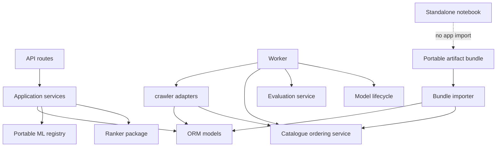

# Service and module catalogue

This page is a code-oriented map of the backend. File paths are relative to the repository root. The listed interfaces reflect the current implementation; future infrastructure is not presented as deployed functionality.

## Runtime services

| Module / service | Main responsibility | Inputs | Outputs / state |
|---|---|---|---|
| `app.main:app` | Create FastAPI application, request IDs, distributed rate limits, security headers, Prometheus metrics, routes and lifecycle hooks | Environment settings, SQL engine, Redis, model directory | HTTP application, OpenAPI contract and private `/metrics/` scrape endpoint |
| `app.api.routes` | Auth, health, catalogue browsing, search, ratings, interactions, watchlists, home rows, recommendations | HTTP request, SQL session, auth dependency | JSON responses and user-state writes |
| `app.api.dependencies` | Resolve authenticated user and enforce self-access for user-scoped routes | Bearer JWT | `User` ORM row or HTTP error |
| `app.db.session` | SQLAlchemy engine, bounded PostgreSQL connection pool, session factory, SQLite foreign-key/WAL setup | `DATABASE_URL`, pool settings | `engine`, `SessionLocal`, `get_db` |
| `app.core.redis_client` | Shared Redis connection and readiness checks | `REDIS_URL` | Shared Redis client or explicit local no-Redis mode |
| `app.core.cache` | Best-effort JSON cache for personalized recommendation responses | Versioned cache key and TTL | Cached response or cache miss; PostgreSQL remains authoritative |
| `app.core.rate_limit` | Atomic Redis sliding-window quotas, with process-local development fallback | IP/user/account scope, quota and time window | Allowed request or Retry-After |
| `app.models.entities` | Relational schema and constraints | SQLAlchemy metadata | Table definitions for catalogue, users, ratings, crawler, jobs, metrics |
| `app.services.recommendation_service` | Build candidate sources, apply explicit preferences, add content/popularity cold-start candidates, exclude seen items, rank with weighted RRF/MMR and coordinate versioned cache | User ID, catalogue/history/preferences, loaded registry | `RecommendationResponse`-ready item rows and signed continuation cursor |
| `app.services.preference_service` | Read and replace explicit per-user recommendation controls | Authenticated user ID and validated preference schema | Persisted preference response |
| `app.ml.portable_models` | Verify/load model artifact formats and score model sources | Portable model directory, ID maps, NPZ/PT/JSON files | In-memory arrays, sparse matrices, source score lists, cold-start content scores |
| `ranker.production_ranker` | Weighted Reciprocal Rank Fusion (RRF), then genre-aware MMR diversification | `Candidate` values and source weights | Ordered `RankedItem` values |
| `app.services.catalogue_service` | Normalize title keys, handle DB collation, append new titles to active index, build/publish order versions | SQLAlchemy session, title IDs | Active `catalogue_sort_index` version |
| `crawler.movie_crawler` | Discover current TMDB movie and TV listings and enrich details/credits | TMDB credentials and API | Idempotent upserts to `movies` |
| `crawler.web_discovery` | Crawl only configured seed hosts, follow robots and sitemap/link discovery, parse JSON-LD Movie/TV entities | Seed URLs, crawl policy, SQL session | `crawl_frontier`, `crawled_pages`, structured catalogue upserts |
| `app.services.evaluation_service` | Scan catalogue health and run offline per-model/hybrid holdout ranking checks | Active registry, MovieLens holdout, current catalogue version | `model_benchmarks` records keyed by bundle/model/catalogue version |
| `app.services.model_lifecycle` | Train challenger orchestration support, compare champion/challenger, compose/promote artifact bundle | Active bundle, challenger bundle, metrics | New immutable bundle and `ACTIVE_BUNDLE` pointer or no promotion |
| `app.worker` | UTC scheduler, DB leases/heartbeat, daily and refresh job execution | Settings, DB, model/data directories | Job state, catalogue updates, metrics, optional new champion |

## Offline and operational scripts

### `training/train_all_models.ipynb`

Canonical training source. It runs in Colab without an application checkout. It installs its own Python dependencies, downloads MovieLens, samples/preprocesses, trains models, exports a portable artifact bundle, verifies tensor/matrix dimensions, computes SHA-256 checksums, and creates a ZIP download.

### `scripts/run_training_notebook.py`

Executes the notebook's code cells locally. It removes only IPython `%` line magic lines (the Colab dependency cell), supplies output/data directories through environment variables, safely extracts the produced ZIP into a `*-verified` directory, and returns that path. It does not import the backend application.

### `scripts/prepare_and_train.py`

Convenience CLI around the runner. It trains a bundle, then by default imports the ZIP into the configured backend. `--no-import` is useful for staging, review, or uploading a bundle elsewhere. It never drops existing application tables.

### `scripts/import_colab_bundle.py`

Validates ZIP paths and checksum manifest, recomputes the bundle ID from payload content, checks user/item ID-map dimensions, inserts/upserts the catalogue/users/ratings in chunks, rebuilds catalogue order, copies the verified bundle into an immutable directory, and replaces the `ACTIVE_BUNDLE` pointer. It uses the provider key `movielens_id` for mapping, while generating permanent application `title_id` values.

### `scripts/migrate_legacy_sqlite.py`

Copies data from an old integer-ID SQLite database into a new schema. It does not rewrite the source DB in place. It constructs an old-ID-to-new-`title_id` mapping and migrates supported dependent records. Review the generated report and validate row counts/foreign keys before switching applications.

## Startup modes

| Task | Command | Process lifecycle |
|---|---|---|
| HTTP API | `uvicorn app.main:app --host 0.0.0.0 --port 8000 --no-access-log` | Long-running, horizontally replicated; request middleware emits structured request-ID, route, status and latency logs |
| Scheduler/worker | `python -m app.worker` | Long-running, one logical owner per job enforced through DB lease |
| Initial training + import | `python scripts/prepare_and_train.py` | Finite CLI; can take a long time and consume substantial RAM/CPU/GPU |
| Training only | `python scripts/prepare_and_train.py --no-import` | Finite CLI; produces ZIP/bundle, leaves DB untouched |
| Import existing bundle | `python scripts/import_colab_bundle.py --bundle <path.zip>` | Finite CLI; requires migrated schema or `AUTO_CREATE_SCHEMA=true` |
| Legacy SQLite migration | `python scripts/migrate_legacy_sqlite.py --source <old.db> --destination <new.db>` | Offline one-shot copy |
| Schema upgrade | `alembic upgrade head` | One-shot release step before API/worker deployment |

## Dependency and state boundaries

- The API requires SQL access and read access to the active model directory.
- The worker requires SQL access, write access to model artifacts and training data, network access to configured crawl sources, and any needed TMDB credential.
- The notebook requires internet access to download MovieLens and enough RAM/CPU/GPU to train the selected configuration. It does not require the API or DB.
- The importer requires the application dependencies and DB write access. It does not contact TMDB or seed web crawling.
- Redis is used for distributed sliding-window rate limits and recommendation response caching. Production requires a reachable Redis service; development can run without it using process-local rate limits and no shared cache.

## Module dependency direction

Keep new code within the owning module: route handlers should validate and delegate; model inference belongs in `app/ml` and the recommendation service; source crawling belongs in `crawler`; final score fusion belongs in `ranker`; schema changes require an Alembic migration and schema documentation update.
