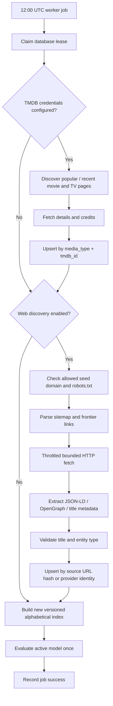

# Metadata Acquisition and Web Discovery Crawler

## Goals and non-goals

The crawler discovers current movie/TV catalogue entries, resolves structured metadata, and upserts records without changing existing title identities. It is not intended to mirror the entire web or scrape arbitrary websites without limits. The current implementation has two adapters:

1. `crawler/movie_crawler.py`: TMDB API adapter for popular/now-playing/upcoming movie and TV discovery, details, credits, and normalized metadata.
2. `crawler/web_discovery.py`: optional configured-domain crawler that discovers pages through seed URLs, sitemaps, and same-domain links, then extracts Schema.org JSON-LD and page metadata where available.

TMDB is generally the stronger source for normalized entertainment metadata. Web discovery is supplementary and only runs for domains explicitly configured by the operator.

## Daily crawl sequence



The worker lease prevents multiple worker instances from running the same named job concurrently. Crawl and upsert operations are designed to be repeatable; a crash may cause a source page to be fetched again.

## TMDB adapter

When a TMDB API key or read token is configured, the adapter discovers pages for movies and TV, retrieves details, and normalizes common fields such as provider ID, title/name, original title, overview, release/first-air year, genres, poster/backdrop paths, popularity, vote average/count, runtime, director/crew, cast, and adult flag. Provider identity is `(media_type, tmdb_id)`, preventing a movie and TV record with the same numeric provider ID from colliding.

The adapter inserts new records with a generated `title_<UUIDv7>` and updates metadata on existing records without changing `title_id`. It does not use display title alone as a unique key.

## Running the crawlers independently

Both adapters are executable modules. They add the backend directory to `sys.path` themselves, and configuration reads `backend/.env` by absolute path, so they work from `backend/` or from inside `backend/crawler/`.

From `backend/`:

```bash
python crawler/movie_crawler.py
python crawler/web_discovery.py
```

From `backend/crawler/`:

```bash
python movie_crawler.py
python web_discovery.py
```

Useful options:

- `movie_crawler.py --pages 1` limits TMDB discovery pages per media type.
- `web_discovery.py --max-pages 20` limits this run.
- Both accept `--json` for machine-readable output.

If TMDB credentials are absent and web discovery is disabled, the command exits cleanly with `enabled: false`; it does not attempt unauthenticated requests. Set `TMDB_API_KEY` or `TMDB_READ_ACCESS_TOKEN` in `backend/.env` to enable TMDB. Set `WEB_CRAWLER_ENABLED=true` and `CRAWLER_SEED_URLS` to enable web discovery.

## Configured-domain web discovery

The web crawler is disabled unless `WEB_CRAWLER_ENABLED` is true and seed URLs are configured. The crawler restricts navigation to the configured seed domains (including valid subdomains according to the domain matcher). It rejects non-public/resolvable hosts and validates redirects against the same policy to reduce SSRF exposure.

The crawler:

- fetches and caches `robots.txt`; a retrieval error fails closed for that host;
- honors user-agent-specific and wildcard disallow rules and crawl-delay declarations;
- enforces a minimum per-host delay and configured request rate;
- supports conditional fetch using `ETag` and `Last-Modified`;
- bounds redirects, retries, connect/read timeouts, response bytes, crawl depth, and page count;
- accepts HTML/XHTML/XML-like responses only;
- discovers URLs from sitemaps and same-domain links;
- extracts structured JSON-LD types such as `Movie` and `TVSeries`, plus selected OpenGraph/page metadata;
- stores frontier/page state so revisits can be scheduled and unchanged pages can return HTTP 304.

A page is not automatically a catalogue title merely because it contains the word “movie”. Extraction must produce a supported entity type and a plausible title. Source URL hash is used for idempotency where no trusted provider ID exists. Operators should review source quality and duplicate resolution policies for each configured domain.

## Crawler data flow and state

`crawl_frontier` stores queued/discovered URLs, domain, depth, priority, state, and scheduling metadata. `crawled_pages` stores URL, validators, fetch status, timestamps, and extracted state. The title catalogue stores normalized metadata and source attribution (`source`, `source_url`, `source_url_hash`, `source_domain`, and optional source metadata JSON).

## Safety and compliance controls

Before enabling a domain, verify its terms of service, copyright permissions, robots policy, privacy requirements, and rate-limit expectations. Do not use the crawler to bypass authentication, paywalls, access controls, or anti-bot measures. Do not add user-supplied arbitrary URLs to the frontier without equivalent validation. Do not store unnecessary personal data.

The crawler's DNS/public-host validation is a defense-in-depth measure, not a complete sandbox. Production deployment should use outbound network egress controls, DNS rebinding protection at the network layer, a restricted service account, and observability for request volume and blocked destinations.

## Operational configuration

Configuration names and defaults are defined in `app/core/config.py`. Relevant groups include:

- `TMDB_API_KEY`, TMDB read access token, page limits, and TMDB request rate;
- `WEB_CRAWLER_ENABLED`, `CRAWLER_SEED_URLS`, and user-agent;
- connect/read timeout, maximum body bytes, maximum redirects, retry count;
- per-host request rate/minimum delay, robots cache TTL;
- maximum crawl pages and depth.

Set explicit limits suitable for the sites being crawled. Avoid setting high request rates simply to increase throughput.

## Failure and retry behavior

Transient network and server failures are retried with bounded backoff. Permanent HTTP failures and policy denials are recorded as page/frontier outcomes rather than retried indefinitely. A 304 response means the stored representation remains current. Failed metadata fetches must not delete or blank an existing catalogue record. Inspect worker logs and crawl state tables to diagnose persistent failures.

## Extending sources

Add a dedicated adapter when a source has an API or stable structured feed. Keep source-specific parsing separate from canonical title normalization. Add tests for duplicate identity, malformed fields, invalid URLs, redirects, robots denial, oversized responses, and repeat runs before enabling a new source in production.
