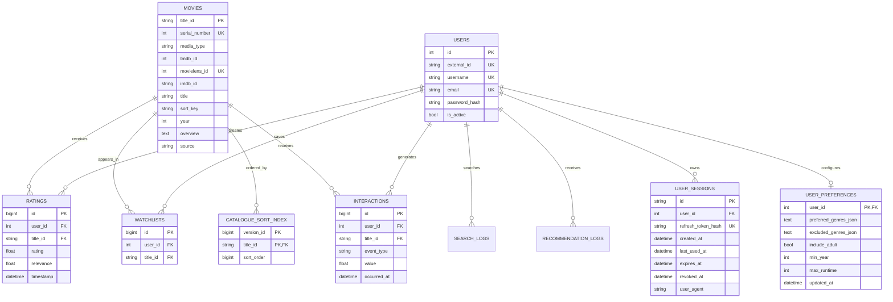

# Database Schema, Identity, and Safe Ordering

## Core invariant

A title's database identity is independent of its display position. `movies.title_id` is the immutable primary key. It is generated for new rows as `title_<UUIDv7>` and remains attached to the same movie/show for its lifetime. Never use alphabetical position, row number, `sort_order`, MovieLens ID, or TMDB ID as the primary key.

`movies.serial_number` is a separate permanent public identifier. It is a positive integer allocated from the single-row `title_serial_sequence` table and rendered as six-digit text at the API and UI layers. It is globally unique across media types, never changes after assignment, and is never reused after a title is deleted. It is not a primary key, foreign key, sort key, row position, or replacement for `title_id`.

## Main entities



`user_preferences` stores one explicit recommendation preference document per user using normalized genre arrays plus adult-content, minimum-year and maximum-runtime controls. It is keyed by `user_id` and cascades on account deletion. Database check constraints enforce year and runtime ranges in addition to Pydantic validation. Preferences are not inferred profile attributes; they are user-editable constraints and ranking hints.

`user_sessions` stores server-side refresh sessions. The primary key is a UUIDv4 string used as the JWT `sid` claim. `refresh_token_hash` is a unique SHA-256 hash of the current opaque refresh token; the raw token exists only in the HttpOnly cookie. Rotation replaces the hash on the same row, so the session identity is stable. `revoked_at` supports logout, logout-all, per-session revocation, and reuse detection. Sessions cascade when their user is deleted. Indexes cover `user_id`, the token hash, `expires_at`, `revoked_at`, and the active-session lookup `(user_id, revoked_at, expires_at)`.

Other operational tables include `catalogue_state`, `job_leases`, `job_runs`, `crawl_frontier`, and `crawled_pages`. Inspect `app/models/entities.py` for the authoritative full column definitions and constraints.

## ID generation

`app/core/ids.py` owns title ID generation. UUIDv7 is time-ordered and globally unique with high probability; the `title_` prefix provides a readable namespace. The ID generator is called only when creating a new title. It is not a sortable catalogue key and must not be regenerated during an update.

Provider IDs are distinct:

- `movielens_id`: source identifier for MovieLens training records; nullable for crawler-only records.
- `tmdb_id`: TMDB identifier; uniqueness is scoped by `(media_type, tmdb_id)`.
- `imdb_id`: IMDb identifier; nullable.

A single database title can accumulate provider identifiers over time. Source identity matching should be performed by trusted provider IDs, not by title string alone. Titles can share names, change names, or have localized names.

## Public serial allocation

`title_serial_sequence` contains one row: `id = 1` and `next_value = N`. Allocation updates and reads that row in the same transaction. SQLite serializes the write through its database writer lock; PostgreSQL and MySQL lock the counter row with `FOR UPDATE`. The `movies.serial_number` unique index is the final duplicate guard.

Every ORM-created title receives a number from a `before_insert` listener. Bulk importers allocate a contiguous batch before `bulk_insert_mappings`. Existing databases are backfilled deterministically by `(created_at, title_id)` in migration `b6e1f4a2c9d7`, then the counter is set above the highest assigned number. The follow-up migration `f2c8d4a6b0e1` rebuilds the SQLite table where required and enforces `NOT NULL` after the deterministic backfill. The migration aborts if any row remains unnumbered; the ORM listener and transactional allocator assign serials to new rows.

The public API formats the integer as zero-padded text with at least six digits. Lookup is always scoped by `(media_type, serial_number)`.

## Why sequential title IDs are unsafe

The proposed behavior of moving the former `tit-004` identity to a newly inserted title at alphabetical position 4 is not a safe primary-key strategy. It changes what an ID means and forces every dependent foreign key, cached API reference, analytics event, and external bookmark to be rewritten. A missed dependent row silently attaches historical user activity to the wrong title. It also creates write amplification and lock contention for large catalogues.

CineRank therefore uses this model:

| title_id | title | sort_order (example) |
|---|---|---:|
| `title_<uuid-A>` | 13 Reasons Why | 1 |
| `title_<uuid-B>` | 13B: Fear Has a New Address | 2 |
| `title_<uuid-C>` | 2012 | 3 |
| `title_<uuid-D>` | 24 (Time Story) | 4 |

The public serial is separate from both identity and ordering:

| title_id | serial_number | title | sort_order |
|---|---|---|---:|
| `title_<uuid-A>` | `000001` | 13 Reasons Why | 1 |
| `title_<uuid-B>` | `000002` | 13B: Fear Has a New Address | 2 |

When a new title is inserted, it gets a new permanent UUIDv7. Its alphabetical position is calculated separately. Existing title IDs and foreign keys do not change.

## Versioned sort index

`catalogue_sort_index` stores `(version_id, title_id, sort_order)`. A rebuild:

1. reads the current catalogue ordered by normalized `sort_key`, then `title_id` as a deterministic tie-breaker;
2. assigns dense positions in a new version;
3. inserts the new version in bounded batches;
4. atomically updates `catalogue_state.active_version` only after the new version is complete;
5. optionally prunes old versions after a retention period.

Readers use the active version. Existing requests that paginate with an older version receive HTTP 409 and must restart, rather than mixing two different orderings. The old version remains intact until publication succeeds.

This approach avoids rewriting the `movies` table and prevents partial sort publication. For large catalogues, the sort-index table can be built using an engine-specific `INSERT ... SELECT` with `ROW_NUMBER()` window functions, if supported and validated. The portable ORM implementation uses bounded application-side batches; benchmark it for very large catalogues.

## SQL patterns

### PostgreSQL

```sql
-- Build a new dense sort version. Use a transaction and a fresh version value.
INSERT INTO catalogue_sort_index (version_id, title_id, sort_order)
SELECT :new_version,
       title_id,
       ROW_NUMBER() OVER (ORDER BY sort_key COLLATE "C", title_id)
FROM movies;

-- Publish only after the insert has completed successfully.
UPDATE catalogue_state
SET active_version = :new_version, published_at = CURRENT_TIMESTAMP
WHERE id = 1;
```

For locale-aware ordering, choose and document a deterministic ICU/libc collation rather than binary code-point ordering. Collation changes can reorder the catalogue; publish a new version and invalidate old cursors.

### MySQL 8+

```sql
INSERT INTO catalogue_sort_index (version_id, title_id, sort_order)
SELECT :new_version,
       title_id,
       ROW_NUMBER() OVER (ORDER BY sort_key COLLATE utf8mb4_bin, title_id)
FROM movies;

UPDATE catalogue_state
SET active_version = :new_version, published_at = CURRENT_TIMESTAMP
WHERE id = 1;
```

Use a compatible character set/collation for the actual schema. MySQL 5.7 lacks window functions; use a tested stored procedure or application-side batch builder rather than assuming this query works.

### SQLite 3.25+

```sql
INSERT INTO catalogue_sort_index (version_id, title_id, sort_order)
SELECT :new_version,
       title_id,
       ROW_NUMBER() OVER (ORDER BY sort_key COLLATE BINARY, title_id)
FROM movies;

UPDATE catalogue_state
SET active_version = :new_version, published_at = CURRENT_TIMESTAMP
WHERE id = 1;
```

SQLite window-function support depends on SQLite version. SQLite is suitable for development/small deployments; its single-writer behavior limits high-write concurrency.

## Safe insertion and ID shift script

There is no primary-key shifting script in CineRank because IDs are never positional. A new title is inserted with a generated primary key and its sort index is rebuilt/published. Example transaction pattern (the SQLAlchemy service is preferred because it applies dialect-aware behavior):

```sql
BEGIN;
INSERT INTO movies (title_id, media_type, title, sort_key, source)
VALUES (:new_title_id, :media_type, :title, :normalised_sort_key, :source);
-- Build a new catalogue_sort_index version in this transaction or a staging
-- transaction, then publish catalogue_state.active_version only on success.
COMMIT;
```

Do not run `UPDATE movies SET title_id = ...`, do not renumber primary keys, and do not update rating/watchlist/interaction foreign keys to simulate an alphabetical move.

## SQL portability and large-database guidance

| Concern | PostgreSQL | MySQL | SQLite | General guidance |
|---|---|---|---|---|
| Dense ordering | `ROW_NUMBER()` | MySQL 8+ `ROW_NUMBER()` | SQLite 3.25+ `ROW_NUMBER()` | Verify engine version before using window functions. |
| Atomic publication | Transactional DML | InnoDB transaction | Transaction | Build new version, then switch one pointer row. |
| Locking | Row-level locks | InnoDB row locks | Database/file writer lock | Keep transactions bounded; test contention. |
| Text collation | Explicit `COLLATE` | Explicit charset/collation | `BINARY`/custom collation | Define product language/order requirements. |
| Bulk inserts | `COPY` or batched insert | `LOAD DATA`/batched insert | Batched insert | Use staging tables for very large imports. |
| Online index build | `CREATE INDEX CONCURRENTLY` | Engine/version-specific | Generally blocks writes | Plan maintenance windows and inspect engine docs. |

For very large catalogues, prefer staging tables, set-based SQL, composite indexes, and a controlled pointer update. Avoid loading the entire catalogue into application memory. The included ORM path is a portable baseline, not a guarantee of optimal performance at hundreds of millions of rows.

## Important indexes and constraints

The ORM defines uniqueness for provider IDs and user/title relationships, indexes common lookup fields, and indexes `(version_id, sort_order)`. Validate actual query plans with production-sized data. If the API filters by media type and genre frequently, consider engine-specific normalized genre tables or JSON indexes rather than relying on substring matching in a delimited string.

## Migration safety

Use Alembic migrations. Before migrating production data:

1. take a tested backup;
2. inspect row counts and foreign-key integrity;
3. migrate in batches if table size requires it;
4. verify provider ID uniqueness and title ID non-nullness;
5. verify every rating/watchlist/interaction title reference resolves;
6. build an initial sort-index version;
7. compare sampled API results before and after cutover.

Do not use `Base.metadata.drop_all()` in a production training/import path. Training and model imports must not erase user data.
